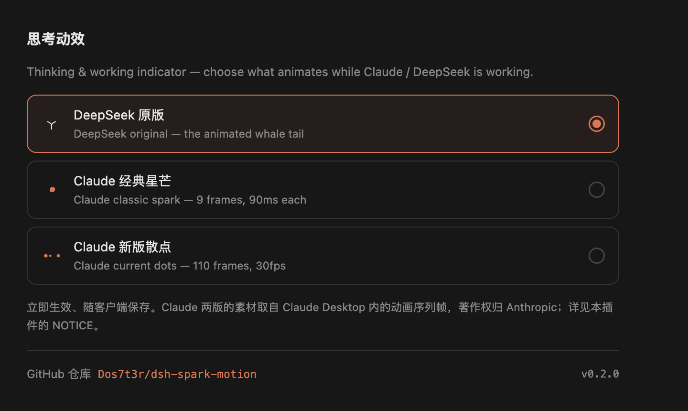
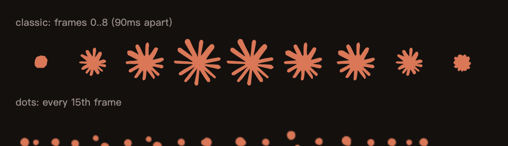

# dsh-spark-motion

**Pick the thinking animation in DeepSeek Harness.** Keep the DeepSeek whale tail, or switch the working indicator to Anthropic's classic Claude spark / Claude's current dots.

[中文说明 →](README.zh.md)

---

## What it does



DeepSeek Harness draws its "working" indicator as a small animated whale tail (`RunningWhaleTail` in `@deepseek-ai/dsh-client-ui-chat`). This plugin lets you replace it, from **Settings → 思考动效**, with one of three options:

| Option | What you get |
|---|---|
| **DeepSeek original** | The stock whale tail. Nothing is touched. |
| **Claude classic spark** | The 9-frame starburst that Claude Desktop used before Sept 2026 — 90ms per frame, vector, crisp at any size. |
| **Claude current dots** | The animation Claude Desktop ships today — 110 frames at 30fps. |

The settings panel also shows the repository link and the installed version, so you can tell at a glance which build you are running. Links open through `window.open(..., "noopener,noreferrer")` — the same route DSH uses for external links — so the app itself never navigates away.

Changes apply instantly, are remembered across restarts (`localStorage`), and cost **~46KB of CSS** for both animations combined — no extra network requests, no React re-renders, no polling.

## How it works

DSH renders the whale as a `<span class="…runningIcon">` containing an animated mask plus a static SVG fallback. The component is hard-coded inside the chat package, so there is no slot to override. Instead of fighting the component tree, this plugin:

1. **Hides** the whale layers with `[class*="runningWhaleAnimated"]` / `[class*="runningWhaleStill"]` — attribute substring selectors, so it survives Vite rehashing class names between builds.
2. **Paints** a `::before` on `[class*="runningIcon"]` filled with `currentColor` and masked by a vertical sprite strip.
3. **Plays** the strip by stepping `mask-position` through one stop per frame:

```css
mask-size: 100% 900%;              /* 9 frames => 9 icon-heights tall          */
/* stop i at t = i/N with y = i*100/(N-1)                                    */
/* mask-position percentages resolve against (box - image) = -(N-1) heights, */
/* so y = i*100/(N-1) lands exactly on frame i.                              */
```

Two things worth knowing if you fork this:

- The sprite strip **must** carry `xmlns` and `width`/`height`. The original ships without them (it is only ever inlined into HTML), and as a CSS mask such an SVG silently renders nothing. `scripts/build.mjs` normalizes it.
- Everything is wrapped in `@media (prefers-reduced-motion: no-preference)`. When the user asks for reduced motion, the plugin does nothing and DSH's own static fallback shows.



*All 9 classic frames plus every 15th dot frame, rendered from the shipped CSS — the mask stepping lands on exactly one frame per stop.*

## Install

The plugin is a normal DSH bundle: a `dsh.client` half plus a `cordis.patch.yml` row.

```bash
# 1. from GitHub into your profile
cd ~/.dsh/profiles/desktop
pnpm add "github:Dos7t3r/dsh-spark-motion"
```

Then add it to the profile's bundle list (`~/.dsh/profiles/desktop/package.json`):

```jsonc
{
  "dsh": {
    "profile": {
      "bundles": [
        /* … existing bundles … */
        "dsh-spark-motion"
      ]
    }
  }
}
```

Restart the DSH app (a page reload is not enough — the bundle roster is resolved at boot), then open **Settings → 思考动效**.

To uninstall, remove the bundle entry and `pnpm remove dsh-spark-motion`.

## Build & test

```bash
node scripts/build.mjs   # regenerates lib/client.js from assets/
node test/smoke.mjs      # loads the bundle with a stubbed ModuleLoader + DOM
```

`test/smoke.mjs` asserts the registration, the selectors, the keyframe geometry (frame count, stop times, stop offsets), mask sizes, durations, the reduced-motion guard, default state and persistence — without launching the app.

## Compatibility

Written against **DSH 6.28899-era** client layout (`runningIcon` / `runningWhale*` class suffixes, `settings.section` slot). Because it keys off class *suffixes* rather than hashed names, minor updates should not break it. If DeepSeek renames those components, the plugin degrades to "DeepSeek original" (nothing painted) rather than breaking the UI.

## Artwork & licensing — please read

The Claude spark frames and the Claude dot frames are **Anthropic PBC's artwork**, extracted from a locally-installed Claude Desktop for interoperability. They are inlined into `lib/client.js` and `assets/`. **They are not covered by this project's MIT license.** See [NOTICE.md](NOTICE.md) for the full disclaimer and for how to remove the artwork and rebuild the plugin with only the DeepSeek option.

The "DeepSeek original" option copies nothing — it simply stops hiding DSH's own element.

This project is unofficial and not affiliated with Anthropic or DeepSeek.

## License

Code: MIT (see [LICENSE](LICENSE)). Artwork: © Anthropic PBC, used with attribution under the conditions in [NOTICE.md](NOTICE.md).
