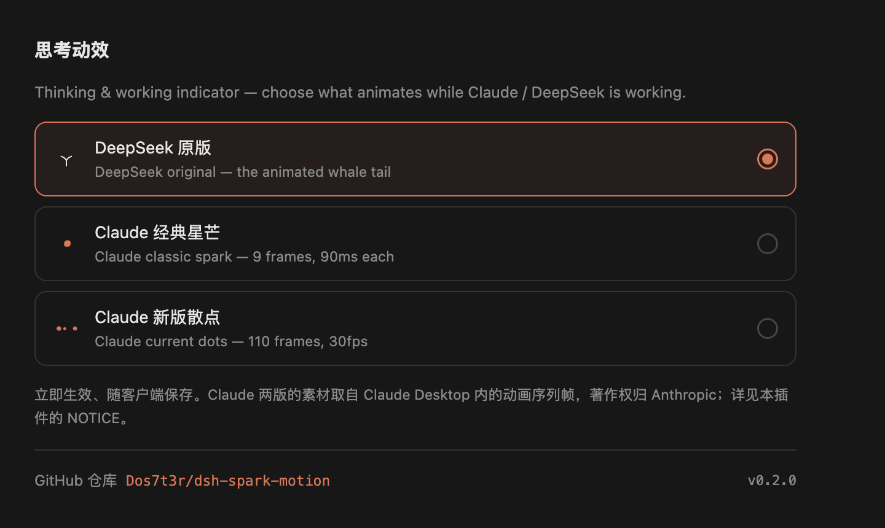
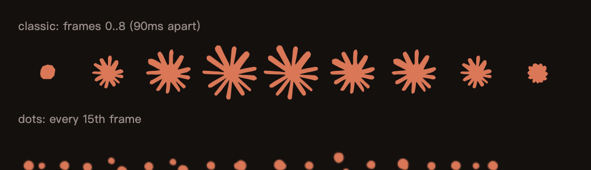

# dsh-spark-motion

**给 DeepSeek Harness 换「思考中」动画。** 保留原版鲸鱼尾巴，或者换成 Anthropic 的 Claude 经典星芒 / Claude 现在这版散点。

[English →](README.md)

---

## 它做什么



DSH 的「工作中」指示器是一条会动的小鲸鱼尾巴（`@deepseek-ai/dsh-client-ui-chat` 里的 `RunningWhaleTail`）。这个插件让你在**设置 → 思考动效**里换成三种之一：

| 选项 | 效果 |
|---|---|
| **DeepSeek 原版** | 原样的鲸鱼尾巴，什么都不动。 |
| **Claude 经典星芒** | 2026 年 9 月之前 Claude Desktop 用的 9 帧星芒，90ms/帧，矢量，任意尺寸都清晰。 |
| **Claude 新版散点** | Claude Desktop 现在这版，110 帧 30fps。 |

设置页底部还会显示仓库地址和当前版本号，一眼就能看出装的是哪个构建。链接走 `window.open(..., "noopener,noreferrer")`（和 DSH 自己打开外链是同一条路径），所以不会把应用本身导航走。

切换**立即生效**、重启后仍然记得（`localStorage`），两套动画一共只占 **~46KB CSS** —— 没有额外网络请求、不触发 React 重渲染、没有轮询。

## 原理

DSH 把鲸鱼渲染成 `<span class="…runningIcon">`，里面一个动画遮罩 + 一个静态 SVG 兜底。这个组件是写死在 chat 包里的，**没有槽位可以覆盖**。所以这个插件不跟组件树较劲，而是：

1. 用 `[class*="runningWhaleAnimated"]` / `[class*="runningWhaleStill"]` **隐藏**鲸鱼两层 —— 用的是 class 后缀子串选择器，Vite 每次构建改 hash 也不受影响；
2. 在 `[class*="runningIcon"]::before` 上铺一层 `currentColor`，用竖排精灵条当遮罩；
3. 用 `mask-position` **逐帧步进**播放：

```css
mask-size: 100% 900%;              /* 9 帧 => 高度是 9 个图标高              */
/* 第 i 帧停在 t = i/N，y = i*100/(N-1)                                     */
/* mask-position 的百分比是相对 (盒子 - 图) 解析的，即 -(N-1) 个图标高，      */
/* 所以 y = i*100/(N-1) 正好落在第 i 帧。                                    */
```

两个踩过的坑，fork 的话要知道：

- 精灵条 **必须**带 `xmlns` 和 `width`/`height`。原始素材两样都没有（它原本只被内联进 HTML），当作 CSS 遮罩会**静默渲染成空白**。`scripts/build.mjs` 会补上。
- 全部逻辑包在 `@media (prefers-reduced-motion: no-preference)` 里。用户开了「减少动态效果」时插件不介入，交给 DSH 自己的静态兜底。



*经典星芒全部 9 帧 + 散点每第 15 帧，全部由已发布的 CSS 渲染 —— 逐帧步进精确落在每一帧上。*

## 与 `dsh-claude-style` 皮肤共存（0.3.0 修复）

如果你同时装了 `dsh-claude-style` 且 `brand: claude`，那套皮肤会做两件事：

```css
body[data-dsh-claude-brand=claude] [data-dsh-claude-part~=running-icon] { display: none }   /* 藏掉 DSH 原生图标 */
body[data-dsh-claude-brand=claude] .dsh-claude-chat-wait-loader { display: inline-flex }      /* 画它自己的四点轨道 */
```

而本插件正是往那个 `running-icon` 元素上画东西 —— 元素被 `display:none` 了，于是你选什么都看不到，只能看到皮肤仿的四点（它其实**不是** Anthropic 的素材，是皮肤自己用 CSS 做的）。0.3.0 起本插件会在选择经典/新版时**重新打开那个槽位**并**停用皮肤那套仿制品**：

```css
html[data-dsh-spark-kind="classic"] body[data-dsh-claude-style] [data-dsh-claude-part~="running-icon"] { display: inline-flex !important }
html[data-dsh-spark-kind="classic"] body[data-dsh-claude-style] .dsh-claude-chat-wait-loader { display: none !important }
```

`kind="dsh"` 时完全不介入，皮肤照旧生效。

## 版本检查

设置页底部有「检查更新」：进页面时自动查一次（结果缓存 6 小时），也可以手动点。查到更新的版本会变成一个 `↑ vX.Y.Z` 胶囊，点开是 release 页面。

数据源是 GitHub API（优先 `releases/latest`，没有 release 就退回 `tags` 取最大版本），全程带 `try/catch`，离线、限流、被墙都只是静默失败，不影响设置页。

> **关于「自动更新」**：插件跑在浏览器的沙箱里，**没有文件系统权限**，没法自己替换 `node_modules` 里的包。所以这里是「检查 + 提示 + 一键打开更新说明」，真正的升级仍是一条命令（见上方安装步骤）。这是能力边界，不是没做。

## 安装

它就是个标准 DSH bundle：一个 `dsh.client` 半 + 一个 `cordis.patch.yml` 行。

```bash
# 1. 从 GitHub 装进 profile
cd ~/.dsh/profiles/desktop
pnpm add "github:Dos7t3r/dsh-spark-motion"
```

然后把包名加进 profile 的 bundle 列表（`~/.dsh/profiles/desktop/package.json`）：

```jsonc
{
  "dsh": {
    "profile": {
      "bundles": [
        /* … 原有 bundles … */
        "dsh-spark-motion"
      ]
    }
  }
}
```

**重启 DSH 应用**（只刷新页面不够 —— bundle 清单是启动时解析的），然后打开 **设置 → 思考动效**。

卸载：删掉 bundle 条目，`pnpm remove dsh-spark-motion`。

## 构建与测试

```bash
node scripts/build.mjs   # 从 assets/ 重新生成 lib/client.js
node test/smoke.mjs      # 用桩 ModuleLoader + DOM 加载 bundle
```

`test/smoke.mjs` 会校验：槽位注册、选择器、关键帧几何（帧数、每帧时间点、每帧位移）、mask 尺寸、时长、「减少动效」守卫、默认值、持久化 —— 全程不启动应用。

## 兼容性

按 **DSH 6.28899 时代**的客户端结构写的（`runningIcon` / `runningWhale*` 类名后缀、`settings.section` 槽位）。因为认的是类名**后缀**而不是 hash，小版本更新一般不会坏。万一 DeepSeek 把这些组件改名了，插件会退化成「DeepSeek 原版」（什么都不画），而不是把界面搞坏。

## 美术与许可 —— 请务必读完

Claude 的星芒帧和散点帧是 **Anthropic PBC 的美术作品**，取自本机安装的 Claude Desktop，用于互操作性目的。它们被内联进 `lib/client.js` 和 `assets/`，**不在本项目的 MIT 许可范围内**。完整免责声明、以及「如何移除这些素材、只用 DeepSeek 选项重新构建」的方法，见 [NOTICE.md](NOTICE.md)。

「DeepSeek 原版」选项不复制任何东西 —— 它只是不再隐藏 DSH 自己的元素。

本项目是非官方的，与 Anthropic、DeepSeek 均无隶属关系。

## 许可

代码：MIT（见 [LICENSE](LICENSE)）。美术素材：© Anthropic PBC，按 [NOTICE.md](NOTICE.md) 的条件署名使用。
